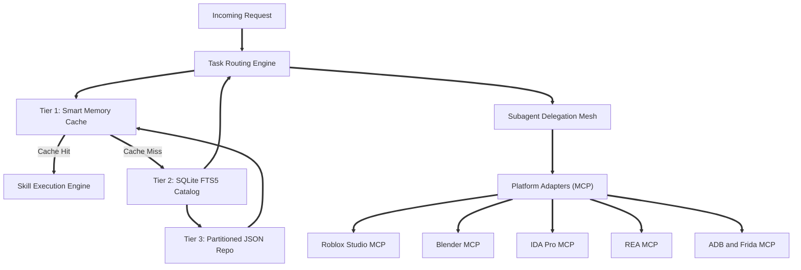
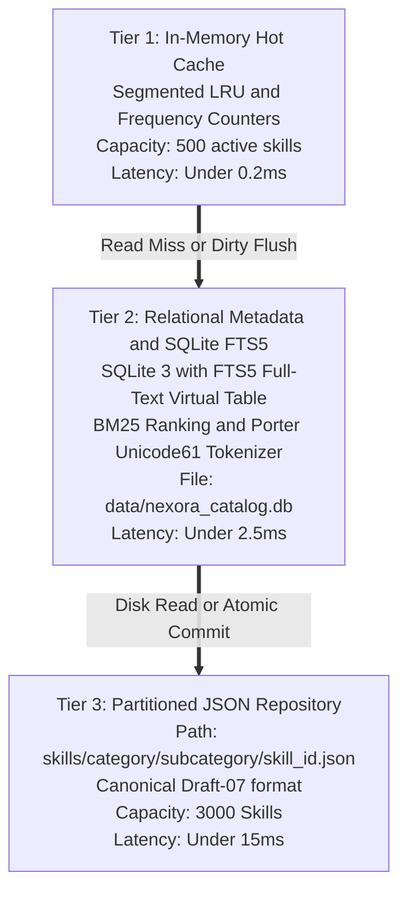
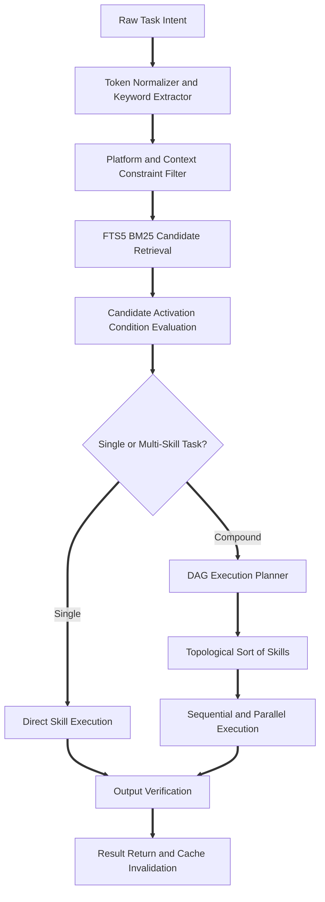
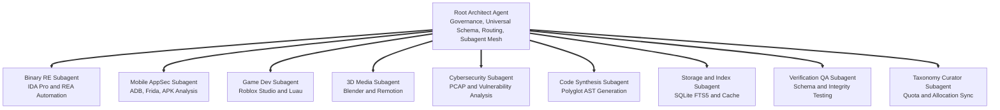

# Nexora AI Architecture Specification

## 1. System Overview

Nexora AI is an autonomous, high-throughput multi-agent engineering platform designed for deep technical automation across binary analysis, reverse engineering, mobile application security, game development, 3D graphics rendering, system architecture, and cognitive orchestration.

### Architectural Core Principles

1. Universal Schema Governance: Every skill adheres strictly to the Draft-07 JSON Schema specification with 19 required fields, ensuring complete structural consistency across the ecosystem.
2. Strict Zero-Comment Policy: Source code, configurations, schemas, and catalogs remain devoid of arbitrary comments, enforcing descriptive naming, self-documenting syntax, and machine parseability.
3. Multi-Tier High-Performance Storage: Read and write paths are separated across an in-memory hot cache, an SQLite FTS5 search index, and a distributed file-backed repository.
4. Intelligent Task Routing: Task dispatch is determined via two-stage filtering and BM25 ranking over normalized intent tokens, context predicates, and platform prerequisites.
5. Isolated Subagent Delegation: The orchestrator coordinates specialized domain subagents using standardized message envelopes and explicit lifecycle state transitions.



## 2. Universal Skill Schema Specification

All skills in Nexora AI must validate against `schemas/skill_schema.json`, configured under JSON Schema Draft-07. The schema mandates 19 essential attributes that define every facet of skill discovery, qualification, execution, and verification.

### The 19 Mandatory Fields

| Field Name | Type | Description |
| :--- | :--- | :--- |
| `id` | String | Unique identifier following naming pattern `^[a-z0-9]+([._:-][a-z0-9]+)*$` |
| `name` | String | Human-readable title of the skill (3 to 128 characters) |
| `purpose` | String | Concise summary of the objective fulfilled by the skill (10 to 512 characters) |
| `category` | String | One of the 16 primary categories defined in the taxonomy matrix |
| `subcategory` | String | Specific sub-domain classification under the parent category |
| `description` | String | Exhaustive operational description detailing capability and mechanics |
| `supported_platforms` | Array | Execution platforms supported (e.g., windows, linux, macos, android, ida_pro) |
| `activation_conditions` | Object | Intent patterns and context prerequisites triggering selection |
| `required_inputs` | Array | Strongly typed list of parameters needed for execution |
| `expected_outputs` | Array | Structured return parameters and format specifications |
| `execution_workflow` | Array | Ordered sequence of actions, descriptions, tools, and expected outcomes |
| `decision_logic` | Object | Conditional branching rules, evaluation logic, and default fallbacks |
| `tool_requirements` | Array | List of MCP or external tools required for execution |
| `dependencies` | Object | System libraries, runtime packages, and dependent skill IDs |
| `safety_restrictions` | Array | Operational constraints, sandbox limits, and safety boundaries |
| `validation_criteria` | Array | Measurable criteria proving correct and successful execution |
| `practical_examples` | Array | Concrete input and output scenarios demonstrating real-world usage |
| `related_skills` | Array | Associated skill IDs for chained composite execution |
| `version` | String | Semantic version number matching format `^[0-9]+\.[0-9]+\.[0-9]+$` |

### Canonical Skill Definition Example

```json
{
  "id": "binary_analysis.ida_pro.decompile_function",
  "name": "IDA Pro Function Decompiler",
  "purpose": "Decompile target function at a specified address into C-like pseudo-code",
  "category": "binary_analysis_and_reverse_engineering",
  "subcategory": "decompilation_and_ast_recovery",
  "description": "Connects to active IDA Pro session via MCP bridge, locates function entry point, and generates decompiled C pseudo-code.",
  "supported_platforms": [
    "windows",
    "linux",
    "ida_pro"
  ],
  "activation_conditions": {
    "intent_patterns": [
      "decompile function",
      "recover c pseudocode",
      "analyze routine at address"
    ],
    "prerequisites": [
      "ida_active_session",
      "binary_loaded"
    ],
    "context_triggers": [
      "target_address_specified"
    ],
    "file_type_associations": [
      ".idb",
      ".i64"
    ]
  },
  "required_inputs": [
    {
      "name": "address",
      "type": "string",
      "description": "Hexadecimal memory address of the target function",
      "required": true
    }
  ],
  "expected_outputs": [
    {
      "name": "pseudocode",
      "type": "string",
      "description": "Generated pseudo-code of the decompiled function",
      "format": "c_source"
    }
  ],
  "execution_workflow": [
    {
      "step_number": 1,
      "action": "locate_function",
      "description": "Verify the address matches an identified function boundary",
      "tool": "get_function_by_address",
      "expected_outcome": "Valid function metadata returned",
      "error_handling": "Throw invalid address exception"
    },
    {
      "step_number": 2,
      "action": "decompile",
      "description": "Invoke hex-rays decompiler engine on the function",
      "tool": "decompile_function",
      "expected_outcome": "Pseudo-code text buffer generated",
      "error_handling": "Fallback to assembly disassembly if decompiler unavailable"
    }
  ],
  "decision_logic": {
    "rules": [
      {
        "condition": "has_decompiler == false",
        "action": "execute_disassembly_fallback",
        "priority": 1
      }
    ],
    "fallback": "disassemble_function"
  },
  "tool_requirements": [
    {
      "tool_name": "decompile_function",
      "server_name": "ida-pro",
      "version_constraint": ">=1.0.0",
      "optional": false
    }
  ],
  "dependencies": {
    "system_libraries": [
      "ida64.exe"
    ],
    "runtime_packages": [
      "ida_mcp"
    ],
    "skill_dependencies": []
  },
  "safety_restrictions": [
    "Read-only operation; modifying IDA database memory is prohibited in this skill"
  ],
  "validation_criteria": [
    "Output pseudocode must be non-empty string containing valid C function signature"
  ],
  "practical_examples": [
    {
      "scenario": "Decompile main function entry point",
      "input": {
        "address": "0x140001000"
      },
      "expected_output": {
        "pseudocode": "int __fastcall main(int argc, const char **argv) { return 0; }"
      }
    }
  ],
  "related_skills": [
    "binary_analysis.ida_pro.disassemble_function",
    "binary_analysis.ida_pro.get_function_callers"
  ],
  "version": "1.0.0"
}
```

## 3. Taxonomy Matrix Architecture

The Nexora AI skill catalog consists of 16 top-level domains divided into 88 subcategories with a combined capacity of exactly 3,000 skills.

### 16 Core Categories and Allocation Quota

| Domain Category | Subcategory Count | Allocation Target | Primary Capabilities |
| :--- | :--- | :--- | :--- |
| `binary_analysis_and_reverse_engineering` | 7 | 250 | Disassembly, AST recovery, symbolic execution, pattern scans, patching, PE/ELF |
| `mobile_security_and_app_analysis` | 6 | 200 | APK reverse engineering, Frida hooking, ADB control, JNI tracing, Mach-O |
| `game_development_and_virtual_worlds` | 6 | 220 | Roblox Luau, scene trees, character physics, procedural worlds, replication |
| `three_dimensional_graphics_and_animation` | 6 | 200 | Blender BMesh, shader generation, armature rigging, keyframing, geometry nodes |
| `cybersecurity_and_penetration_testing` | 6 | 210 | PCAP analysis, vulnerability heuristics, malware profiling, fuzzing, sandboxing |
| `system_architecture_and_os_internals` | 5 | 180 | Win32 API, Linux eBPF, memory managers, kernel drivers, concurrency primitives |
| `software_engineering_and_architecture` | 6 | 220 | AST refactoring, clean patterns, polyglot codegen, static analysis, test harnesses |
| `web_technologies_and_browser_automation` | 5 | 190 | CDP browser control, bundle reconstruction, DOM observation, Electron debugging |
| `ai_ml_and_cognitive_orchestration` | 6 | 210 | LLM chains, RAG vector retrieval, dataset tuning, benchmarks, ONNX optimization |
| `cloud_devops_and_infrastructure` | 5 | 170 | Docker multi-stage builds, Kubernetes Helm, GitHub Actions, OpenTofu, telemetry |
| `data_engineering_and_storage_systems` | 5 | 180 | SQLite FTS5 search, LRU caches, DDL migrations, ETL batching, Parquet storage |
| `hardware_embedded_and_iot` | 5 | 150 | Firmware unpacking, UART/JTAG, Cortex-M analysis, IoT protocols, SDR signals |
| `network_protocols_and_traffic_analysis` | 5 | 170 | Binary wire protocols, TLS negotiation, async socket IO, HTTP/3 QUIC, bandwidth |
| `media_processing_and_creative_automation` | 5 | 150 | Remotion composition, audio synthesis, canvas filters, FFmpeg transcoding, UV maps |
| `security_governance_and_compliance` | 5 | 140 | Zero-trust policies, secret isolation, SBOM auditing, append logs, sandboxing |
| `autonomous_agent_orchestration_and_routing` | 5 | 160 | Subagent lifecycles, intent parsing, smart cache sync, self-healing, consensus |
| **Total** | **88** | **3,000** | **Complete Universal Technical Coverage** |

### Directory Taxonomy

Skills reside on disk in a structured directory hierarchy matching the taxonomy:

```
skills/
├── binary_analysis_and_reverse_engineering/
│   ├── disassembly_and_control_flow/
│   ├── decompilation_and_ast_recovery/
│   ├── symbolic_execution_and_taint/
│   ├── signature_and_pattern_scanning/
│   ├── binary_patching_and_reassembly/
│   ├── executable_format_parsing/
│   └── type_and_struct_reconstruction/
├── mobile_security_and_app_analysis/
│   ├── apk_decompilation_and_repackaging/
│   ├── frida_dynamic_instrumentation/
│   ├── adb_automation_and_device_control/
│   ├── native_library_analysis/
│   ├── ipc_and_component_security/
│   └── ios_ipa_and_macho_inspection/
└── [remaining 14 categories]/
```

## 4. Storage Tier and Multi-Tier Storage Architecture

Nexora AI maintains a tiered data storage hierarchy designed for sub-millisecond retrieval of hot skills and scalable indexing of all 3,000 skills across three distinct storage tier levels.



### Storage Interaction Model

- Read Flow: Router queries Tier 1 Hot Memory Cache. If found, returns skill in 0.2ms. If missing, queries Tier 2 SQLite FTS5 for ranked candidate IDs, loads corresponding records into Tier 1, and serves request.
- Write Flow: New or updated skills are validated against `schemas/skill_schema.json`. Upon successful validation, the file is atomically written to Tier 3. A database transaction updates Tier 2 SQLite metadata and FTS5 index. Tier 1 cache entries are refreshed or marked dirty.

## 5. SQLite FTS5 Indexing Engine

Tier 2 provides full-text query matching using SQLite FTS5 virtual tables.

### Database DDL Schema

```sql
CREATE TABLE IF NOT EXISTS skills_metadata (
    id TEXT PRIMARY KEY,
    name TEXT NOT NULL,
    category TEXT NOT NULL,
    subcategory TEXT NOT NULL,
    version TEXT NOT NULL,
    file_path TEXT NOT NULL,
    platforms_csv TEXT NOT NULL,
    created_at INTEGER NOT NULL,
    updated_at INTEGER NOT NULL
);

CREATE VIRTUAL TABLE IF NOT EXISTS skills_fts USING fts5 (
    id,
    name,
    purpose,
    category,
    subcategory,
    description,
    capability_tokens,
    content='skills_metadata',
    content_rowid='rowid',
    tokenize='porter unicode61'
);

CREATE TRIGGER IF NOT EXISTS trg_skills_insert AFTER INSERT ON skills_metadata BEGIN
    INSERT INTO skills_fts (rowid, id, name, purpose, category, subcategory, description, capability_tokens)
    VALUES (new.rowid, new.id, new.name, '', new.category, new.subcategory, '', new.platforms_csv);
END;

CREATE TRIGGER IF NOT EXISTS trg_skills_delete AFTER DELETE ON skills_metadata BEGIN
    INSERT INTO skills_fts (skills_fts, rowid, id, name, purpose, category, subcategory, description, capability_tokens)
    VALUES ('delete', old.rowid, old.id, old.name, '', old.category, old.subcategory, '', old.platforms_csv);
END;
```

### Full-Text Ranking and Search Execution

The FTS5 engine ranks candidates using the BM25 algorithm with custom weights applied across fields:

```sql
SELECT 
    m.id, 
    m.name, 
    m.category, 
    m.subcategory, 
    m.file_path,
    bm25(skills_fts, 10.0, 5.0, 3.0, 2.0, 2.0, 1.0, 4.0) AS rank_score
FROM skills_fts f
JOIN skills_metadata m ON f.rowid = m.rowid
WHERE skills_fts MATCH 'decompil* OR ast'
ORDER BY rank_score
LIMIT 20;
```

## 6. Task Routing and Dynamic Skill Dispatch Engine

The task routing engine resolves user or agent intent into concrete skill execution plans.



### Intent Resolution Pipeline

1. Lexical Tokenization: The intent string is stripped of punctuation and normalized into lowercased n-grams and stem tokens.
2. Context Guardrails: The router identifies the active platform environment (e.g., Windows OS, IDA Pro connection, active ADB session). Skills incompatible with the active environment are excluded.
3. Scoring & Pruning: SQLite FTS5 scores candidates with BM25. Activation conditions are matched against context variables.
4. DAG Assembly: When a task spans multiple sequential steps (e.g., disassemble binary -> identify cryptographic constants -> extract string references), an acyclic dependency graph is assembled and executed.
5. Fallback Resolution: If primary skill execution fails or raises a tool error, the decision logic triggers predefined fallback actions.

## 7. Smart Caching Layer

The Smart Cache sits between the execution engine and persistent storage to minimize disk and database overhead.

### Cache Policies and Mechanics

- Segmented Eviction (SLRU): Divides cache space into a probationary segment (first-time accessed skills) and a protected segment (frequently accessed skills). Prevents one-off batch scans from evicting core skills.
- Adaptive Working Set: Monitors hit rates and dynamically adjusts memory allocation between metadata tokens and parsed JSON skill trees.
- Write-Through Consistency: Modifications to skill schemas or metadata immediately update memory cache, SQLite FTS5 tables, and disk files in a single atomic sequence.
- Pre-Warming: On system boot, the 50 most frequently utilized skills across the top domains are pre-loaded into Tier 1 cache.

## 8. Platform Adapters & Tool Integration

Nexora AI interfaces with system environments via Model Context Protocol (MCP) servers and native platform adapters.

### Supported Platforms and Integrations

| Adapter | Target System | Supported Capabilities |
| :--- | :--- | :--- |
| `Roblox_Studio` | Roblox Studio Engine | Luau code execution, game tree search, model insertion, scene generation |
| `blender` | Blender 3D Suite | Procedural BMesh generation, material shaders, armature rigging, animation |
| `ida-pro` | IDA Pro Interactive Disassembler | Function disassembly, hex-rays decompilation, xref traversal, stack struct repair |
| `rea` | Reverse Engineering Assistant | Dynamic Frida tracing, native load image inspection, swift demangle, packet dissect |
| `stitch` | Stitch Design System | Text-to-screen UI generation, variant generation, design system sync |
| `adb_frida` | Android Debug Bridge / Frida | Device package management, logcat capture, dynamic JavaScript hook injection |

### Adapter Sandbox Safeguards

- Memory isolation prevents external tool crashes from terminating the orchestrator.
- Path traversal guardrails block access outside the authorized workspace directories.
- Parameter sanitizer strips unsafe injection characters from shell-based commands.

## 9. Subagent Delegation Model

Complex engineering operations are partitioned and delegated across specialized subagents governed by the root Architect Agent.

### Subagent Registry



### Task Envelope Protocol

Communication between the orchestrator and subagents utilizes a standardized message envelope:

```json
{
  "message_id": "c57d8120-fa40-4217-a110-381c817282b0",
  "timestamp": "2026-11-08T00:45:00Z",
  "sender_id": "architect_agent",
  "recipient_id": "binary_reverse_engineering_agent",
  "task_id": "task_re_func_009",
  "intent": "decompile_function_and_extract_constants",
  "payload": {
    "skill_id": "binary_analysis.ida_pro.decompile_function",
    "inputs": {
      "address": "0x140029b30"
    }
  },
  "priority": "HIGH",
  "correlation_id": "corr_89218201",
  "status": "dispatched"
}
```

### Delegation Lifecycle States

1. `planned`: Coordinator constructs task envelope with validated input parameters.
2. `dispatched`: Message transmitted to designated subagent inbox.
3. `in_progress`: Subagent begins execution of skill workflow steps.
4. `awaiting_feedback`: Execution paused requiring human confirmation or parameter clarification.
5. `completed`: Workflow executed successfully, verified by QA, and structured completion report returned.
6. `failed`: Execution encountered non-recoverable exception; failure report sent to coordinator.
7. `fallback_triggered`: Failure intercepted by coordinator and routed to designated fallback agent.

## 10. Architectural Integrity and Verification

Nexora AI enforces automated verification gates to ensure complete stability and standard compliance:

1. Draft-07 JSON Schema Validation: Every registered skill is strictly validated against `schemas/skill_schema.json`.
2. Static Zero-Comment Auditor: Scans all newly generated files and rejects any pull or commit containing single-line, multi-line, hash, HTML, or SQL comment syntax.
3. Taxonomy Quota Balancer: Confirms that total skill counts across the 16 categories remain balanced and equal to the 3,000 skill allocation target.
4. Automated Regression Harness: Runs deterministic test suites across all platform adapters to detect interface breakage.
